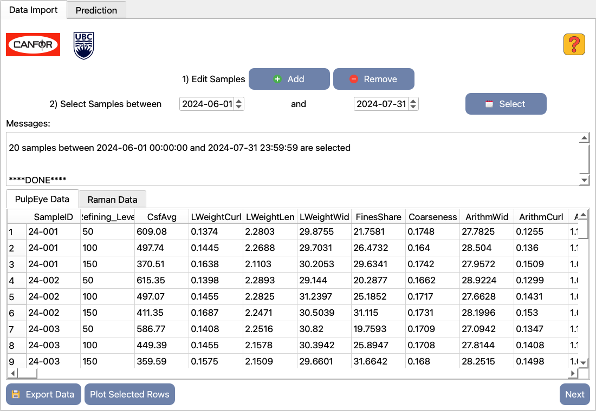
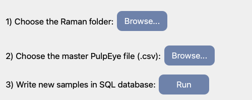
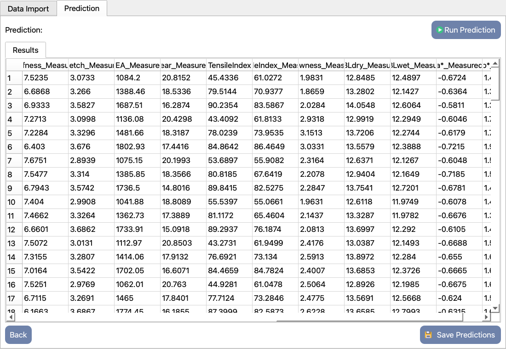

# PulpBrain

**PulpBrain** is a desktop application for Raman-spectroscopy data management and pulp/paper quality prediction, developed in collaboration between the **University of British Columbia (UBC)** and **Canfor**. It imports Raman spectra recorded on Wasatch spectrometers, stores them in a local MySQL database next to PulpEye fibre measurements, and runs pre-trained XGBoost models that predict paper-property targets from the fused Raman + fibre data. The underlying approach is described in [Poursorkh *et al.*, Anal. Chem. 2025, 97, 15808](https://doi.org/10.1021/acs.analchem.5c01768). Everything is driven from a PyQt5 GUI.



> **Research software, not a product.** PulpBrain grew out of a research project and has no installer; it runs from source. This repository ships a **fully synthetic sample dataset** so you can try the whole workflow without any real mill data (see [Try it with the sample data](#4-try-it-with-the-sample-data)). **Only one model is bundled** (tensile index) so that the pipeline can be tested end to end; the other models were trained on proprietary Canfor data and are not distributed (see [`Models/README.md`](Models/README.md) for how to use your own). The bundled model was trained on real data, so predictions on the synthetic data demonstrate that the pipeline works, not that the numbers are meaningful.

## Contents

1. [What it does](#what-it-does)
2. [Installation (step by step)](#installation-step-by-step)
3. [Set up the database](#3-set-up-the-database)
4. [Try it with the sample data](#4-try-it-with-the-sample-data)
5. [Using your own data](#using-your-own-data)
6. [Troubleshooting](#troubleshooting)
7. [Repository layout](#repository-layout) · [Known limitations](#known-limitations) · [Authors](#authors) · [License](#license)

---

## What it does

```
Raman CSV files ─┐   (replicate scans averaged, first 49 dead pixels zeroed)
                 ├─► MySQL (standalone_validation) ◄── PulpEye CSV export
                 │      matched by SampleID + refining level
                 ▼
   "Select" by date range  →  selected_variables table (282 fibre/PulpEye features)
                 ▼
   Raman pixels 50–699:  SNV → polynomial background removal (deg. 4) → Savitzky–Golay
                 ▼
   fused features (282 + 650 = 932)  → RobustScaler → XGBoost model(s) from `Models/`
                 ▼
   Predicted vs. measured table  → Excel export
```

- **Raman import** — Wasatch WP785 spectra from the BarrelWise Python API, and ENLIGHTEN exports (versions 1.1.12, 1.6.13, 2.0.1, 2.2.7).
- **MySQL storage** — nine tables (`raman`, `batchinfo`, `targets`, `pulpeye`, `fibersummary`, `fiberkinks`, `fwtdist`, `fwtwidthdist`, `fiberdistributions`).
- **Viewer** — sort tables, select rows, overlay spectra (**Plot Selected Rows**), export to Excel (**Export Data**).
- **Prediction** — one XGBoost model per property (this repository ships **TensileIndex** only), shown next to the measured values stored in the database, exportable to Excel (**Save Predictions**).
- Imports run in a background thread, so the window stays responsive.

The application is built to host one model per property for: Caliper, Bulk, Density, Air resistance, Smoothness, Brightness, Yellowness, Opacity, Scattering, Absorption, L\*, a\*, b\*, CSF, Tear, Burst, BL, Stretch, Stiffness, TEA, TensileIndex, ZSBLdry and ZSBLwet (these also appear as `…_Measured` columns when measured values are in the database). Only **TensileIndex** is bundled; its feature importances are in `Models/Features_Importance.xlsx`.

---

## Installation (step by step)

Tested with **Python 3.10** and **MySQL 9.3** on macOS (Apple Silicon); the lab deployment runs on Windows. MySQL 8.0+ should work too.

### 1. Install MySQL Server

| OS | Command / link |
|---|---|
| macOS | `brew install mysql && brew services start mysql` |
| Windows | [MySQL Installer](https://dev.mysql.com/downloads/installer/) → "Server only" |
| Ubuntu/Debian | `sudo apt install mysql-server && sudo systemctl start mysql` |

Check that it is running: `mysql -u root -p -e "SELECT VERSION();"`. PulpBrain connects to the **default port 3306**.

### 2. Get the code and a Python environment

```bash
git clone https://github.com/Hooman-tz/PulpBrain.git
cd PulpBrain

# Conda (recommended)
conda create -n pulpbrain python=3.10
conda activate pulpbrain

# ...or a plain virtual environment
# python3.10 -m venv .venv && source .venv/bin/activate    (Windows: .venv\Scripts\activate)

pip install -r requirements.txt
```

`requirements.txt` pins `scikit-learn==1.4.2` and `xgboost==2.0.3` **exactly**: the models in `Models/` are pickles and may not load, or may predict differently, with other versions.

On Linux, Qt may need system libraries: `sudo apt install libxcb-xinerama0 libxcb-cursor0`.

### 3. Set up the database

The app does **not** create its own tables, and the database **must be named `standalone_validation`** (the name is used inside the SQL scripts and several queries).

**a) Create the database and a dedicated (non-root) user** — in a MySQL shell (`mysql -u root -p`):

```sql
CREATE DATABASE standalone_validation;
CREATE USER 'pulpbrain'@'localhost' IDENTIFIED BY 'choose_a_strong_password';
GRANT ALL PRIVILEGES ON standalone_validation.* TO 'pulpbrain'@'localhost';
```

**b) Create the tables (once)** from the repository folder:

```bash
mysql -u pulpbrain -p < sql/01_schema_raman.sql
mysql -u pulpbrain -p < sql/02_schema_pulpeye.sql
```

> ⚠️ `sql/01_schema_raman.sql` starts with `DROP DATABASE IF EXISTS standalone_validation`. Run it **only** against an empty or throw-away database.

**c) Tell PulpBrain how to connect:**

```bash
cp config.example.ini config.ini       # Windows: copy config.example.ini config.ini
```

Edit `config.ini`:

```ini
[database]
host = localhost
user = pulpbrain
password = choose_a_strong_password
database = standalone_validation
```

`config.ini` is git-ignored. Alternatively set the environment variables `PULPBRAIN_DB_HOST`, `PULPBRAIN_DB_USER`, `PULPBRAIN_DB_PASSWORD`, `PULPBRAIN_DB_DATABASE` (they take precedence).

### Start the app

```bash
python pulpbrain.py
```

Click **Get Started**. Keep the terminal visible: progress and errors from the import and prediction steps are printed there.

---

## 4. Try it with the sample data

`sample_data/` holds a synthetic dataset — **no real measurements**: 20 samples (`LR24-001` … `LR24-020`), each with 3 replicate Wasatch WP785 scans and 3 refining levels (50/100/150), 60 PulpEye rows in total. Details and the generator script: [`sample_data/README.md`](sample_data/README.md).

**Import**

1. On the **Data Import** tab click **Add**.
2. **1) Choose the Raman folder → Browse…** → select `sample_data/raman`.
3. **2) Choose the master PulpEye file → Browse…** → select `sample_data/pulpeye_sample.csv`.
4. **3) Write new samples in SQL database → Run.** Wait for the *"Data processing finished"* message (a few seconds).
   Lines such as `Skipping duplicate entry for SampleID: 24-001` in the terminal are normal (the same spectrum is offered once per refining level).



**Select samples**

5. Set the date pickers to **2024-06-01** and **2024-07-31** (the sample dates are taken from the PulpEye file), then click **Select**. The Messages box should report **20 samples**, and the *PulpEye Data* / *Raman Data* tabs fill with 60 / 20 rows.
6. Optional: click rows and press **Plot Selected Rows** to overlay spectra; **Export Data** writes both tables to Excel.

**Predict**

7. Click **Next** (or open the **Prediction** tab) and press **Run Prediction**. Two matplotlib windows with the raw and the preprocessed spectra may open — close them if they get in the way.
8. The *Results* table shows, per sample and refining level, the predicted **TensileIndex** and the `_Measured` values stored in the database (random dummies for the sample data). Columns are sorted alphabetically, so scroll right to find `TensileIndex` next to `TensileIndex_Measured`. **Save Predictions** exports the table to Excel.



The "measured" values in the sample data are random dummies in the same units as the model outputs, so a rough agreement is expected but means nothing scientifically.

**Starting over:** use **Remove** on the Data Import tab to delete a sample from all tables by ID (the `LR` prefix is pre-filled; type e.g. `24-001`), or re-run the schema scripts on a throw-away database. Importing the same samples twice is harmless — duplicates are skipped.

---

## Using your own data

**Raman files.** Put all spectra of a session in one folder (sub-folders are scanned). File names must start with the sample ID `LRyy-nnn` (e.g. `LR24-015`); consecutive files with the same prefix are treated as replicates and averaged.

- *BarrelWise API / PulpBot (WP785):* a headerless CSV with one column of 1024 pixel intensities, named `LRyy-nnn…_YYMMDD-HHMMSS.csv` (the timestamp is read from the name).
- *ENLIGHTEN:* the standard spectrum CSV export of ENLIGHTEN 1.1.12, 1.6.13, 2.0.1 or 2.2.7; the acquisition time is read from the file.

**PulpEye master file (`.csv`).** The importer reads a wide export **by column position**, with data starting on the 13th row and the sample name (`LRyy-nnn-<refining level>`) in the second column. The precise layout is documented, column by column, by `sample_data/generate_sample_data.py` and by the title row of `sample_data/pulpeye_sample.csv`; use that file as the template. Save Excel exports as CSV first.

Samples are matched to PulpEye rows by the `LRyy-nnn` prefix; all refining levels of a sample found in the PulpEye file are imported.

---

## Troubleshooting

| Symptom | Likely cause / fix |
|---|---|
| `Missing database setting 'host'…` on start | `config.ini` is missing or incomplete — copy `config.example.ini` (step 3c). |
| `Access denied for user…` | Wrong user/password in `config.ini`, or the user lacks privileges on `standalone_validation`. |
| `Can't connect to MySQL server on 'localhost:3306'` | The server is not running, or listens on another port (the port is not configurable). |
| `Unknown database` / `Table '…' doesn't exist` | The database or the tables were not created — repeat step 3a/3b. |
| `ModuleNotFoundError` | The Python environment is not activated, or `pip install -r requirements.txt` was not run. |
| Warnings about unpickling / `InconsistentVersionWarning`, or an XGBoost error when loading models | scikit-learn/xgboost versions differ from the pinned ones. |
| `ImportError … scipy/sparse/linalg/_propack…` (macOS) | scipy ≥ 1.15 pip wheel not loadable on your macOS; use the pinned `scipy<1.15`. |
| `Could not load the Qt platform plugin "xcb"` (Linux) | Install the Qt system libraries from step 2. |
| 0 samples after **Select** | The date range must cover the PulpEye *sample* date, not the Raman date. |
| Nothing imported / sample skipped | The Raman file name does not start with `LRyy-nnn`, or that sample is missing from the PulpEye file; check the terminal output. |

---

## Repository layout

```
PulpBrain/
├── pulpbrain.py               # the application (GUI, import, prediction) — start here
├── requirements.txt           # pinned Python dependencies
├── config.example.ini         # database credentials template (copy to config.ini)
├── LICENSE · NOTICE           # Apache-2.0, attribution and notes
├── sql/
│   ├── 01_schema_raman.sql        # creates the database and the Raman/target tables (run once)
│   ├── 02_schema_pulpeye.sql      # creates the PulpEye/fibre tables (run once)
│   └── build_selected_variables.sql   # builds the feature table; run by the app on "Select"
├── Models/                    # demo model, placeholder scaler, feature list, importances, README
├── sample_data/               # synthetic Raman + PulpEye files and their generator
├── assets/                    # logos and button icons used by the GUI
└── docs/images/              # screenshots used in this README
```

## Known limitations

This is research code and has not been refactored; contributions are welcome. Things to be aware of:

- The database name `standalone_validation` and MySQL port 3306 are hard-coded in places; the `database` entry in `config.ini` only affects the import step.
- During prediction the `RobustScaler` is **re-fitted on the selected batch** (`fit_transform`) rather than applying the saved scaler statistics, so results depend on which samples are selected together. This reproduces the original lab behaviour and is left unchanged for now.
- The whole application lives in a single ~2100-line file; there is no automated test suite or installer.
- Spectra are stored as averaged raw intensities; only pixels 50–699 are used by the models.

Ideas for future work: split the code into modules (`db`, `preprocessing`, `prediction`, `ui`), add unit tests for the pure preprocessing functions, a SQLite backend to remove the MySQL requirement, a headless batch mode, and confidence intervals for the predictions.

## Authors

- **Zahra Poursorkh**, PhD — Department of Chemistry, University of British Columbia
- **Hooman Tavakolizadeh** — Department of Chemistry, University of British Columbia ([hooman.iran97@gmail.com](mailto:hooman.iran97@gmail.com))
- **Ashton Christy**, PhD — Department of Chemistry, University of British Columbia; original Raman import script (2018)
- **Prof. Edward Grant** — Department of Chemistry, University of British Columbia

Developed under the UBC–Canfor research partnership. The approach is described in [Poursorkh *et al.*, Anal. Chem. 2025, 97, 15808](https://doi.org/10.1021/acs.analchem.5c01768).

## License

The code is released under the **[Apache License 2.0](LICENSE)**. The synthetic data in `sample_data/` is dedicated to the public domain under **[CC0 1.0](sample_data/LICENSE)**. See [`NOTICE`](NOTICE) for details on the bundled model (the data it was trained on is not included), the Canfor/UBC logos (trademarks, not covered by the license) and third-party dependencies such as PyQt5 (GPL v3).
